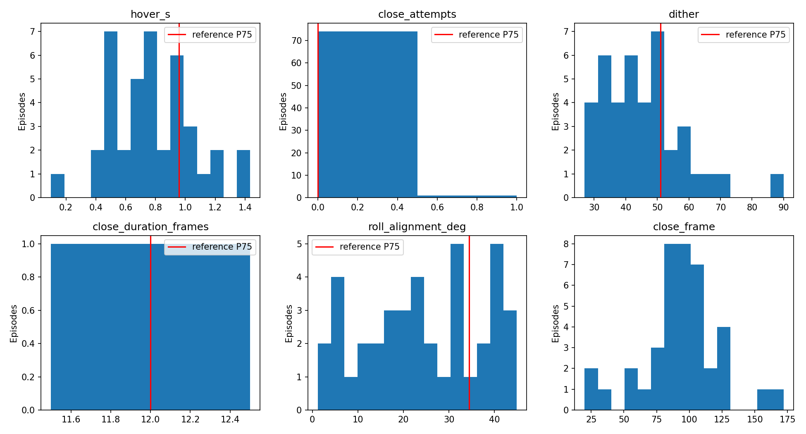
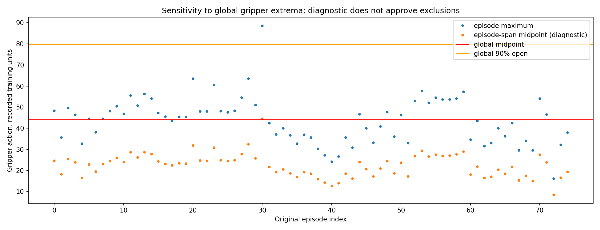

# SO-101 grasp audit — approval required before data building

Source: `/home/rpuser1/Sim-to-Real-SO-101-Workshop/datasets/pick_place_v1`. 75 episodes / 16448 frames at 30 fps.

Global action closed/open: 0.0770412758 / 88.674881; midpoint 44.3759611; 90% open 79.815097.
Arm speed P25: 4.68012632 degrees/s (five calibrated joint velocities, Euclidean norm).

Close is the first downward midpoint crossing with at least ten consecutive below-midpoint frames; an initially closed gripper is not a crossing. Hover sums low-speed intervals from episode start to close, including settling before approach. Attempts count close-to-reopen cycles before the measured lift (or episode end if lift is absent); initial opening is excluded. Dither counts per-joint nonzero velocity sign reversals during the two seconds before close; exact zeros are ignored, with no smoothing. Duration spans the last sample at least 90% open before close to the first sample at most 10% open before returning to 90% open. Unobserved endpoints remain missing, never zero.

Roll alignment is abs(fold90(wrist_roll - fold90(cube_face_yaw - shoulder_pan))) with the recorder's calibrated state conversion. Cube yaw uses the cube-local axis with the largest horizontal projection. This is a joint-angle proxy rather than gripper forward kinematics, so tilted cubes need video review. Lift requires a new base-Z rise of at least 0.01 m above the height at close, strictly after close. This does not establish contact, release or task success. A rise above frame zero elsewhere is reported separately.

P75 thresholds use NumPy's deterministic linear percentile on lifted, sustained-global-close episodes excluding the five mandated bad IDs. Any measured metric strictly above its P75 is hesitant; ties remain below the screen. An observed but incomplete 90%-10% transition is also hesitant. This upper-quartile screen finds demonstrations for review; percentile-only labels do not prove a failed grasp. A bad label comes from a mandated exclusion or a missing close/lift measurement; non-mandated bad labels remain provisional.

Clean means no flag among measurable global metrics; it does not verify every metric. In particular, missing opening endpoints do not establish a fast closure. A percentile based on one measured duration equals that observation and provides no useful population estimate; review the opening-threshold policy before making closure-speed claims.

| Metric | Measured N | Reference N | P0 | P25 | P50 | P75 | P95 | P100 | Hesitant threshold |
|---|---:|---:|---:|---:|---:|---:|---:|---:|---:|
| hover_s | 40 | 38 | 0.1 | 0.558333 | 0.783333 | 0.941667 | 1.18 | 1.43333 | 0.958333333 |
| close_attempts | 75 | 38 | 0 | 0 | 0 | 0 | 0 | 1 | 0 |
| dither | 40 | 38 | 27 | 36.5 | 44 | 51.25 | 66.35 | 90 | 51 |
| close_duration_frames | 1 | 1 | 12 | 12 | 12 | 12 | 12 | 12 | 12 |
| roll_alignment_deg | 40 | 38 | 1.20275 | 13.8347 | 24.1222 | 35.8343 | 42.7233 | 44.9141 | 34.4579565 |
| close_frame | 40 | 38 | 20 | 81.75 | 96 | 110.25 | 131.3 | 172 | — |

**Bad: 37 episodes / 6813 frames**

0, 1, 3, 4, 6, 17, 31, 32, 33, 34, 35, 36, 37, 38, 39, 40, 41, 42, 43, 45, 46, 47, 49, 51, 60, 61, 62, 63, 64, 65, 66, 67, 68, 69, 72, 73, 74

**Hesitant: 20 episodes / 5272 frames**

2, 5, 8, 9, 11, 12, 18, 20, 21, 23, 25, 27, 28, 30, 50, 52, 56, 57, 59, 71

**Clean: 18 episodes / 4363 frames**

7, 10, 13, 14, 15, 16, 19, 22, 24, 26, 29, 44, 48, 53, 54, 55, 58, 70

**Threshold limitation and unresolved observations**

35 episodes lack a sustained global-midpoint close; 35 never reach the midpoint. Only 1 reach global 90% open, and duration is measurable in 1. Yet 75 episodes show a rise above their initial cube height somewhere. Missing global metrics cannot establish physical failure.

Unresolved close IDs: 1, 4, 6, 17, 31, 32, 33, 34, 35, 36, 37, 38, 39, 40, 41, 42, 43, 45, 46, 47, 49, 51, 60, 61, 62, 63, 64, 65, 66, 67, 68, 69, 72, 73, 74.

Non-mandated provisional bad IDs requiring review: 1, 4, 17, 31, 32, 33, 34, 35, 36, 37, 38, 39, 40, 41, 42, 43, 45, 46, 47, 49, 60, 61, 62, 63, 64, 65, 66, 67, 68, 69, 73, 74.

Episode-span min/max sensitivity finds 75 sustained closes, 74 later lifts, and 67 durations. These are diagnostic values in the CSV, not replacement thresholds. An episode's maximum need not be physically fully open, so adopting local spans also requires an explicit decision.

**Proposed exclusions for approval: 0, 3, 6, 51, 72 (mandated).** Retain hesitant episodes in main pending approval; propose clean, measurable close/lift episodes for grasp windows. Review unresolved episodes and choose a gripper-threshold policy before treating additional bad labels as exclusions. No further exclusions are approved by this report.

| Episode | Classification | Measurement status | Reasons |
|---:|---|---|---|
| 0 | bad | measured | mandated exclusion |
| 1 | bad | threshold_unresolved | no sustained global-midpoint crossing (threshold unresolved); no measured post-close lift |
| 2 | hesitant | measured | hover_s>P75; dither>P75 |
| 3 | bad | measured | mandated exclusion |
| 4 | bad | threshold_unresolved | no sustained global-midpoint crossing (threshold unresolved); no measured post-close lift |
| 5 | hesitant | measured | close_attempts>P75 |
| 6 | bad | threshold_unresolved | mandated exclusion; no sustained global-midpoint crossing (threshold unresolved); no measured post-close lift |
| 7 | clean | measured | within measured thresholds |
| 8 | hesitant | measured | hover_s>P75 |
| 9 | hesitant | measured | roll_alignment_deg>P75 |
| 10 | clean | measured | within measured thresholds |
| 11 | hesitant | measured | hover_s>P75 |
| 12 | hesitant | measured | roll_alignment_deg>P75 |
| 13 | clean | measured | within measured thresholds |
| 14 | clean | measured | within measured thresholds |
| 15 | clean | measured | within measured thresholds |
| 16 | clean | measured | within measured thresholds |
| 17 | bad | threshold_unresolved | no sustained global-midpoint crossing (threshold unresolved); no measured post-close lift |
| 18 | hesitant | measured | hover_s>P75; dither>P75; roll_alignment_deg>P75 |
| 19 | clean | measured | within measured thresholds |
| 20 | hesitant | measured | hover_s>P75 |
| 21 | hesitant | measured | dither>P75 |
| 22 | clean | measured | within measured thresholds |
| 23 | hesitant | measured | roll_alignment_deg>P75 |
| 24 | clean | measured | within measured thresholds |
| 25 | hesitant | measured | roll_alignment_deg>P75 |
| 26 | clean | measured | within measured thresholds |
| 27 | hesitant | measured | hover_s>P75; dither>P75; roll_alignment_deg>P75 |
| 28 | hesitant | measured | hover_s>P75; dither>P75 |
| 29 | clean | measured | within measured thresholds |
| 30 | hesitant | measured | hover_s>P75; roll_alignment_deg>P75 |
| 31 | bad | threshold_unresolved | no sustained global-midpoint crossing (threshold unresolved); no measured post-close lift |
| 32 | bad | threshold_unresolved | no sustained global-midpoint crossing (threshold unresolved); no measured post-close lift |
| 33 | bad | threshold_unresolved | no sustained global-midpoint crossing (threshold unresolved); no measured post-close lift |
| 34 | bad | threshold_unresolved | no sustained global-midpoint crossing (threshold unresolved); no measured post-close lift |
| 35 | bad | threshold_unresolved | no sustained global-midpoint crossing (threshold unresolved); no measured post-close lift |
| 36 | bad | threshold_unresolved | no sustained global-midpoint crossing (threshold unresolved); no measured post-close lift |
| 37 | bad | threshold_unresolved | no sustained global-midpoint crossing (threshold unresolved); no measured post-close lift |
| 38 | bad | threshold_unresolved | no sustained global-midpoint crossing (threshold unresolved); no measured post-close lift |
| 39 | bad | threshold_unresolved | no sustained global-midpoint crossing (threshold unresolved); no measured post-close lift |
| 40 | bad | threshold_unresolved | no sustained global-midpoint crossing (threshold unresolved); no measured post-close lift |
| 41 | bad | threshold_unresolved | no sustained global-midpoint crossing (threshold unresolved); no measured post-close lift |
| 42 | bad | threshold_unresolved | no sustained global-midpoint crossing (threshold unresolved); no measured post-close lift |
| 43 | bad | threshold_unresolved | no sustained global-midpoint crossing (threshold unresolved); no measured post-close lift |
| 44 | clean | measured | within measured thresholds |
| 45 | bad | threshold_unresolved | no sustained global-midpoint crossing (threshold unresolved); no measured post-close lift |
| 46 | bad | threshold_unresolved | no sustained global-midpoint crossing (threshold unresolved); no measured post-close lift |
| 47 | bad | threshold_unresolved | no sustained global-midpoint crossing (threshold unresolved); no measured post-close lift |
| 48 | clean | measured | within measured thresholds |
| 49 | bad | threshold_unresolved | no sustained global-midpoint crossing (threshold unresolved); no measured post-close lift |
| 50 | hesitant | measured | dither>P75 |
| 51 | bad | threshold_unresolved | mandated exclusion; no sustained global-midpoint crossing (threshold unresolved); no measured post-close lift |
| 52 | hesitant | measured | hover_s>P75; dither>P75; roll_alignment_deg>P75 |
| 53 | clean | measured | within measured thresholds |
| 54 | clean | measured | within measured thresholds |
| 55 | clean | measured | within measured thresholds |
| 56 | hesitant | measured | dither>P75 |
| 57 | hesitant | measured | hover_s>P75; roll_alignment_deg>P75 |
| 58 | clean | measured | within measured thresholds |
| 59 | hesitant | measured | roll_alignment_deg>P75 |
| 60 | bad | threshold_unresolved | no sustained global-midpoint crossing (threshold unresolved); no measured post-close lift |
| 61 | bad | threshold_unresolved | no sustained global-midpoint crossing (threshold unresolved); no measured post-close lift |
| 62 | bad | threshold_unresolved | no sustained global-midpoint crossing (threshold unresolved); no measured post-close lift |
| 63 | bad | threshold_unresolved | no sustained global-midpoint crossing (threshold unresolved); no measured post-close lift |
| 64 | bad | threshold_unresolved | no sustained global-midpoint crossing (threshold unresolved); no measured post-close lift |
| 65 | bad | threshold_unresolved | no sustained global-midpoint crossing (threshold unresolved); no measured post-close lift |
| 66 | bad | threshold_unresolved | no sustained global-midpoint crossing (threshold unresolved); no measured post-close lift |
| 67 | bad | threshold_unresolved | no sustained global-midpoint crossing (threshold unresolved); no measured post-close lift |
| 68 | bad | threshold_unresolved | no sustained global-midpoint crossing (threshold unresolved); no measured post-close lift |
| 69 | bad | threshold_unresolved | no sustained global-midpoint crossing (threshold unresolved); no measured post-close lift |
| 70 | clean | measured | within measured thresholds |
| 71 | hesitant | measured | dither>P75 |
| 72 | bad | threshold_unresolved | mandated exclusion; no sustained global-midpoint crossing (threshold unresolved); no measured post-close lift |
| 73 | bad | threshold_unresolved | no sustained global-midpoint crossing (threshold unresolved); no measured post-close lift |
| 74 | bad | threshold_unresolved | no sustained global-midpoint crossing (threshold unresolved); no measured post-close lift |

All 379 raw file SHA-256 hashes matched before/after, including videos and sidecars. Source manifest aggregate: `b52c0a9e67b7ebf88e647c15155ac103b7868c72d74792568d4d0144d7b4810c`. No training data built. STOP: approve exclusions, hesitant handling and threshold policy before Phase 3.
